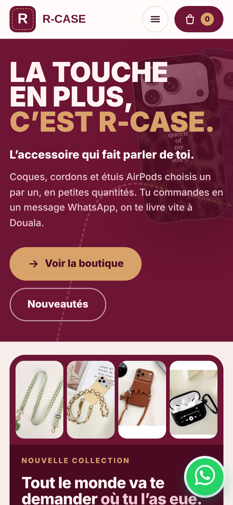
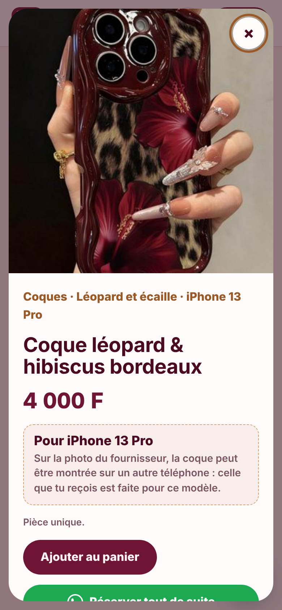
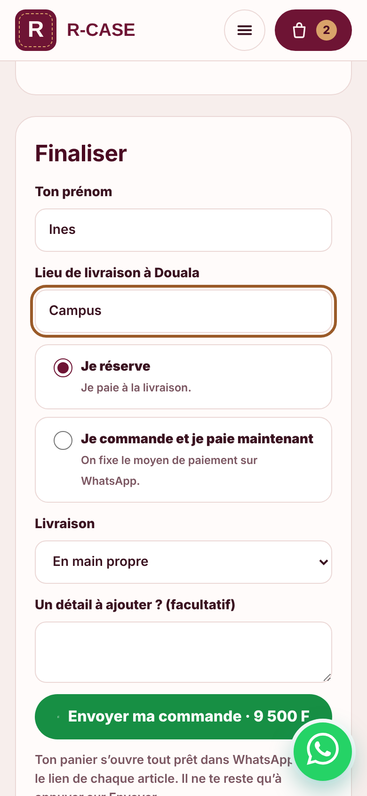
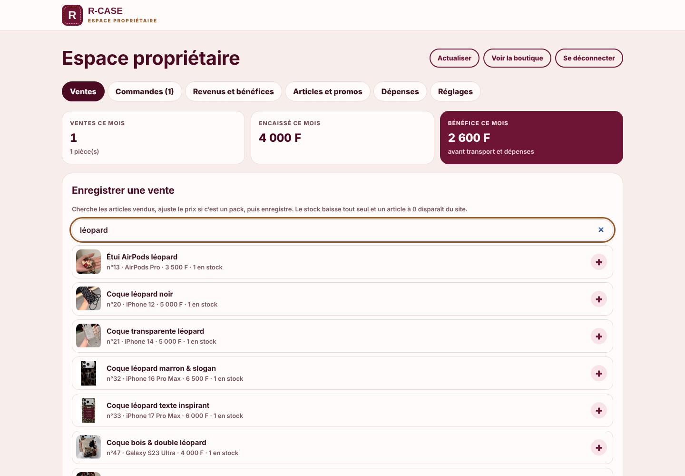
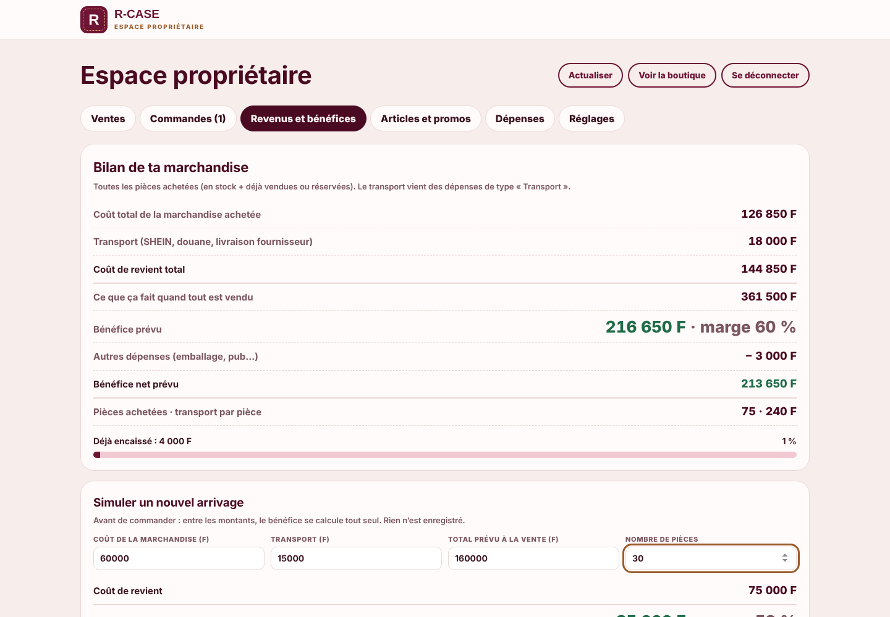
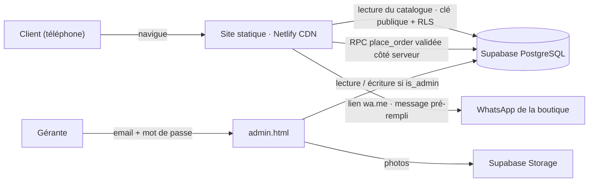

# R-Case · boutique en ligne d'accessoires de téléphone

**Site en ligne : [r-case.netlify.app](https://r-case.netlify.app)**

R-Case est ma petite entreprise d'accessoires de téléphone à Douala (Cameroun) : coques iPhone et Samsung, cordons et étuis AirPods, souvent en un seul exemplaire.
Ce dépôt contient le site complet :
- une **boutique** pour les clients ;
- un **espace propriétaire privé** pour gérer le catalogue, les ventes, le stock et les bénéfices ;
- une **base de données sécurisée**.

> *English summary: a mobile-first e-commerce site for my phone-accessories business in Douala. Customers browse the catalogue and send a ready-made order through WhatsApp (no payment gateway needed). A private admin dashboard handles products, stock, sales tracking and profit. Static front-end on Netlify, Postgres back-end on Supabase with Row Level Security, a hardened order RPC, and a security audit with fixes (see [SECURITY.md](SECURITY.md)).*

| Boutique (mobile) | Fiche article | Panier → WhatsApp |
|---|---|---|
|  |  |  |

| Espace propriétaire : ventes | Bénéfices et simulateur |
|---|---|
|  |  |

*Les captures de l'espace propriétaire utilisent des données de démonstration.*

---

## Le problème à résoudre

- Mes clients sont des étudiants qui commandent depuis leur téléphone, souvent via WhatsApp.
- Une solution de paiement en ligne coûte cher pour une petite activité, et l'API WhatsApp Business est payante.
- Il me fallait aussi suivre mon stock, mes ventes et mes bénéfices, ce que je faisais à la main.

## La solution

**Côté client (`index.html`)**
- Le catalogue filtre par catégorie, sous-catégorie et modèle de téléphone.
- Chaque article indique le modèle exact pour lequel il est fait.
- Un panier, puis **un message WhatsApp pré-rempli**, avec les articles, le total et une référence de commande. Cela passe par un simple lien `wa.me`, sans API payante.
- La commande est aussi enregistrée dans la base, via une fonction sécurisée.
- Un article vendu disparaît automatiquement de la boutique.
- Le site est pensé d'abord pour le mobile et chargé rapidement : JavaScript sans framework, images optimisées.

**Côté propriétaire (`admin.html`, accès privé)**
- **Ventes** : je recherche l'article, j'ajuste le prix pour un pack, j'enregistre. Le stock baisse, l'historique est gardé et s'exporte en CSV pour Excel. L'annulation remet la pièce en stock.
- **Commandes** : celles du site arrivent toutes seules, avec un suivi du statut et du paiement.
- **Articles** : prix, promos, stock, photos, prix d'achat privé et marge par pièce.
- **Bénéfices** : coût de la marchandise, transport, chiffre d'affaires prévu, marge, plus un simulateur pour préparer un nouvel arrivage.
- **Dépenses** et **réglages** : textes du site et catégories.

## Architecture



| Couche | Technologie |
|---|---|
| Interface | HTML, CSS, JavaScript (sans framework), routage par hash |
| Hébergement | Netlify : CDN, HTTPS, en-têtes de sécurité via `_headers` |
| Base de données | Supabase (PostgreSQL) avec Row Level Security |
| Authentification | Supabase Auth, un compte gérante unique, inscriptions fermées |
| Fichiers | Supabase Storage (photos des articles) |

## Sécurité

J'ai mené un **audit de type pentest** sur le site en ligne, puis corrigé chaque faille. Le détail est dans [SECURITY.md](SECURITY.md).

En résumé :
- **Row Level Security sur toutes les tables.** Le public ne lit que le catalogue. Commandes, prix d'achat, dépenses et comptes restent réservés à la gérante.
- **Une fonction de commande `place_order` protégée** (`SECURITY DEFINER`). Elle vérifie les données, recalcule les prix côté serveur pour qu'un client ne puisse pas fixer son prix, limite le débit contre le spam et contrôle la quantité et le stock.
- **`is_admin()` vérifie un compte confirmé dans `auth.users`**, et pas seulement l'email présent dans le jeton.
- **Des en-têtes HTTP** : Content-Security-Policy stricte, `X-Frame-Options: DENY`, `nosniff`, `Referrer-Policy`, `Permissions-Policy`.
- **Un script tiers chargé avec Subresource Integrity (SRI)**, et un admin exclu des moteurs de recherche et du cache.
- **Des envois de fichiers limités** aux images de 3 Mo maximum. Les inscriptions sont fermées et les URL de redirection d'authentification sont verrouillées.

## Structure du dépôt

```
index.html            boutique
admin.html            espace propriétaire
_headers              en-têtes de sécurité Netlify
assets/css/site.css   design (charte R-Case)
assets/js/common.js   accès aux données (Supabase ou mode démo)
assets/js/site.js     boutique, panier, message WhatsApp
assets/js/admin.js    espace propriétaire
assets/js/config.js   URL et clé publique Supabase (vides ici)
data/catalogue.json   catalogue de démonstration
products/             photos des articles
supabase/             schéma SQL, règles RLS, données de démo, correctifs de sécurité
docs/captures/        captures d'écran
```

## Lancer le projet

**En local, en mode démo, sans base de données** :
```bash
python3 -m http.server 8000
# puis ouvrir http://localhost:8000
```
Le site utilise alors `data/catalogue.json`.

**Avec Supabase** :
1. Crée un projet Supabase.
2. Exécute dans l'ordre `supabase/1-structure.sql`, `2-donnees-demo.sql`, `3-mon-acces.sql` (avec ton email) et `5-securite.sql`.
3. Renseigne `assets/js/config.js`.
4. Dépose le dossier sur Netlify.

## Réalisation

Projet personnel, mené de bout en bout pour ma propre activité (octobre–novembre 2026) :
- analyse du besoin ;
- choix de l'architecture ;
- conception de l'expérience client et de l'espace de gestion ;
- mise en place de Supabase et Netlify ;
- audit de sécurité et application des correctifs ;
- mise en production ;
- utilisation au quotidien.

Le code a été écrit avec l'aide d'un assistant IA (Claude, d'Anthropic), que j'ai dirigé, testé et corrigé à chaque étape.

**Ce que ce projet m'a appris** :
- modéliser une base relationnelle et sécuriser l'accès avec des règles RLS ;
- penser comme un attaquant pour trouver les failles de sa propre application ;
- livrer un produit réel, utilisé par de vrais clients, et l'améliorer à partir de leurs retours.

## Contact

Roushda Ruth YOUBI · étudiante ingénieure à l'UCAC-ICAM (Douala)
[LinkedIn](https://www.linkedin.com/) · [ton.email@exemple.com](mailto:ton.email@exemple.com)

---
© 2026 R-Case. Le code est visible à titre de portfolio. Le nom, le logo, les visuels et les photos appartiennent à R-Case.
